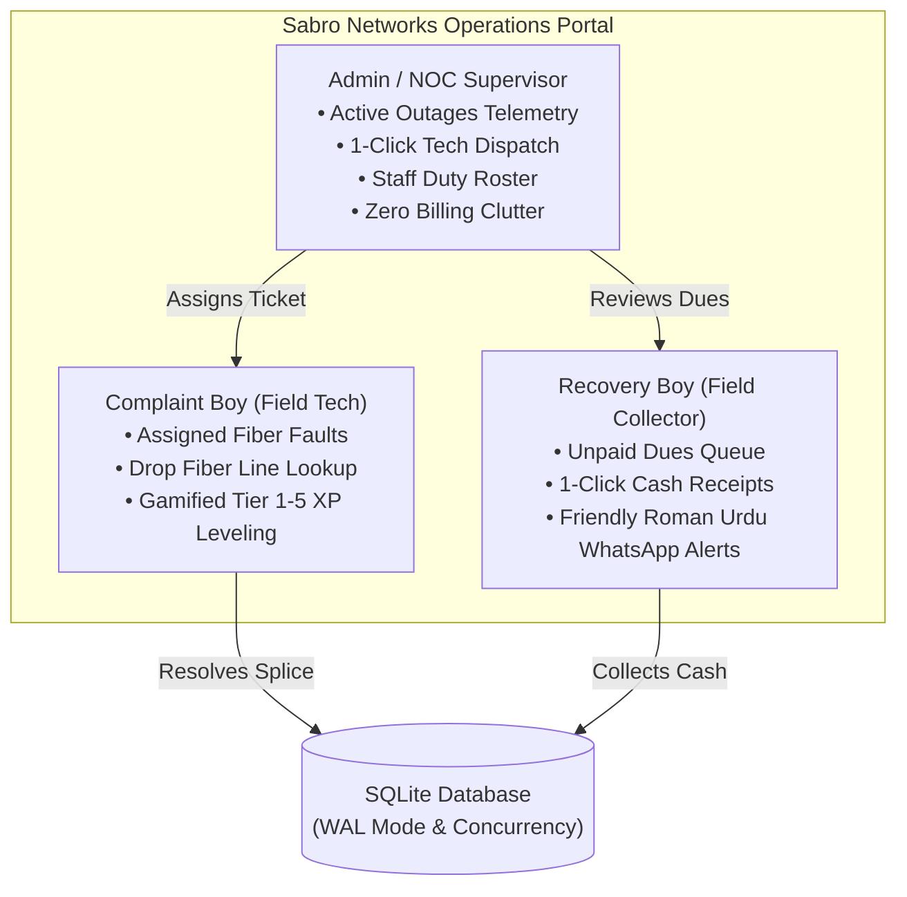

# 🌐 Sabro Networks &bull; FTTH Telecom & Operations Management System

<div align="center">

[](https://github.com/sabroservices/Sabro-Networks/actions)
[](https://www.python.org/)
[](https://flask.palletsprojects.com/)
[](https://render.com/)
[-brightgreen?style=flat-square)](#-automated-testing)

**A high-performance operations, ticketing, and billing recovery platform designed specifically for FTTH (Fiber-To-The-Home) Internet Service Providers.**

[Key Features](#-key-features) &bull; [Architecture](#-system-architecture) &bull; [Access Control](#-access-control) &bull; [Deploy to Render](#-deploy-to-render) &bull; [Local Setup](#-local-development)

</div>

---

## 🏛️ System Architecture



---

## ✨ Key Features

### 1. Dedicated, Role-Segregated Desks
* **NOC Complaints Desk (Admin)**: Focused entirely on open subscriber tickets, optical telemetry indicators, technician dispatch, and engineering duty rosters. Non-operational dealer sync and financial tables are segregated to preserve focus.
* **Technician Desk (Complaint Boy)**: Shows only assigned work orders. Includes drop wire details (FDB box number, pole location, optical fiber core color: Blue, Orange, Green, Brown), resolution notes, and gamified XP progression across 5 technician tiers.
* **Recovery Desk (Recovery Boy)**: Streamlined field collection interface showing pending subscriber dues, one-tap cash collection with automatic 30-day validity extension, and single-click friendly WhatsApp reminders.

### 2. Telecom WhatsApp Automations
* **Polite Bill Reminders**: Short, friendly Roman Urdu messages without technical or hardware jargon.
* **Field Tech Dispatch**: Automatically sends full subscriber location, optical box, and fiber color to field technicians.
* **Customer Restoration Alerts**: Instant resolution confirmations sent to customers upon ticket completion.
* **Defaulters Summary**: Rapid overview of overdue accounts with direct WhatsApp contact buttons.

### 3. Enterprise-Grade Reliability
* **High-Concurrency SQLite**: Configured with Write-Ahead Logging (`WAL`), 25-second busy timeout, and automatic database backups.
* **Universal Cloud Compatibility**: Built with automatic detection for serverless filesystems and long-running production processes.
* **Cryptographic Security**: Passwords hashed with scrypt/PBKDF2 with automatic in-place upgrades.

---

## 🔐 Access Control

On initial initialization, the system provisions **zero dummy data** and **a single unrestricted Main Admin account** (`ahmedbaloch`). Additional role-isolated staff logins (Field Technicians and Recovery Staff) can be created anytime under **Staff & User Logins**.

---

## 🚀 Deploy to Render (100% Free)

You can launch Sabro Networks with a free domain on [Render](https://render.com/) with zero credit card:

1. Push this repository to your GitHub account.
2. Go to **[render.com](https://render.com/)** and sign in with GitHub.
3. Click **"New +"** &rarr; Select **"Blueprint"**.
4. Choose your `Sabro-Networks` repository.
5. Render reads the included `render.yaml` configuration and provisions the web service.
6. Click **"Apply"** &mdash; your site will be live on an SSL domain (`https://sabro-networks-portal.onrender.com`) with automated Git deploys enabled.

---

## 💻 Local Development

### Prerequisites
* Python 3.10, 3.11, or 3.12
* Git

### Installation
```bash
# 1. Clone the repository
git clone https://github.com/sabroservices/Sabro-Networks.git
cd Sabro-Networks

# 2. Create and activate a virtual environment
python -m venv venv
.\venv\Scripts\activate   # On Windows
source venv/bin/activate  # On Linux / macOS

# 3. Install dependencies
pip install -r requirements.txt

# 4. Initialize clean database schema & single Main Admin
python init_db.py

# 5. Launch the application
python app.py
```

The portal will be running locally at **`http://127.0.0.1:5000`**.

---

## 🧪 Automated Testing

All 24 unit, security, and integration tests can be executed locally with:

```bash
python -m unittest test_security_suite.py test_enterprise_suite.py test_company_system.py
```

### Verified Test Criteria
* `[PASS]` Clean digital bill slip verification (zero PPPoE or hardware clutter).
* `[PASS]` Strict role boundary enforcement between Admin, Technician, and Recovery staff.
* `[PASS]` Complete FTTH subscriber lifecycle (Creation, hardware parameters, deposits, edits).
* `[PASS]` 6 Telecom WhatsApp automation endpoints.
* `[PASS]` Gamified technician progression levels (Tiers 1–5).
* `[PASS]` Atomic database backup creation and download integrity.

---

## 📁 Repository Structure

```text
├── .github/
│   ├── workflows/ci.yml       # GitHub Actions automated test runner
│   └── ISSUE_TEMPLATE/        # Standardized issue and bug report forms
├── api/
│   └── index.py               # Cloud serverless compatibility entrypoint
├── app.py                     # Main application logic and route handlers
├── db.py                      # Database schema, migrations, connection pool
├── init_db.py                 # CLI database initializer and seeder
├── render.yaml                # Render Blueprint automated deployment config
├── requirements.txt           # Pinned Python package dependencies
├── templates/                 # Responsive HTML views (Bootstrap 5.3)
├── static/                    # Icons, SVG avatars, logos
├── START_AUTO_SYNC.bat        # Background watcher for automatic GitHub pushes
├── QUICK_PUSH.bat             # 1-click manual commit and push utility
└── test_*.py                  # 24-test verification suite
```

---

## 📄 License & Attribution

Developed for **Sabro Networks (FTTH)** in partnership with **Vshatkay Solutions Agency**.  
All rights reserved.
